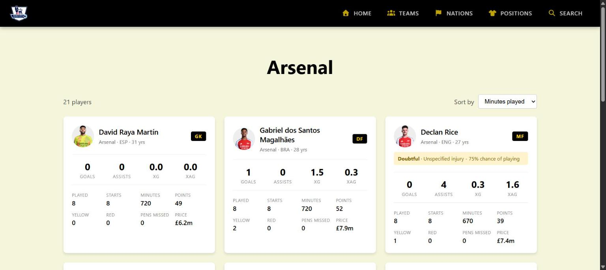
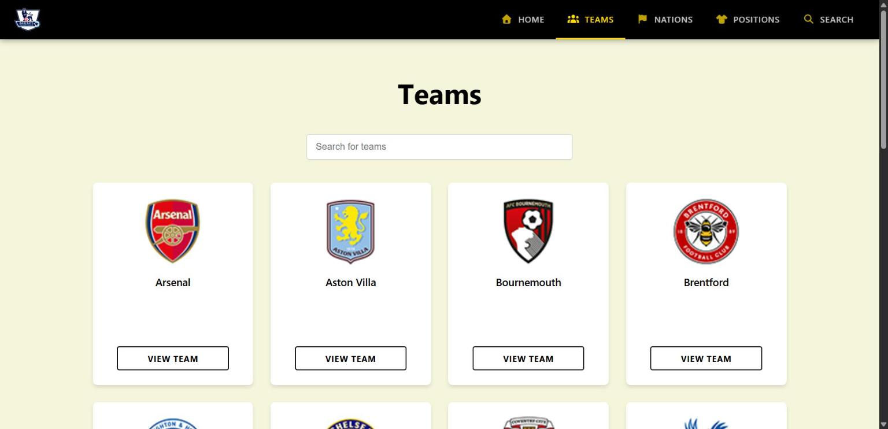
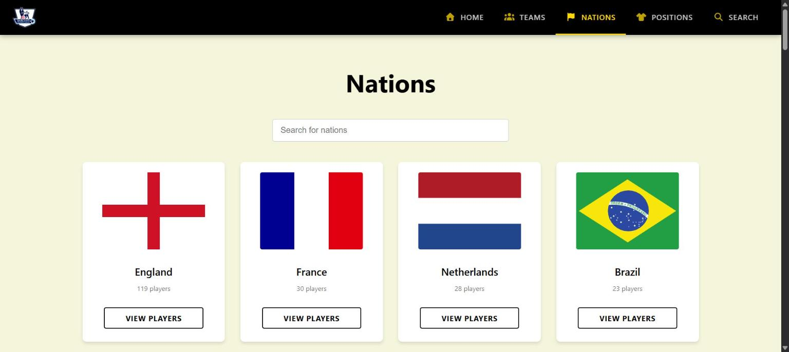
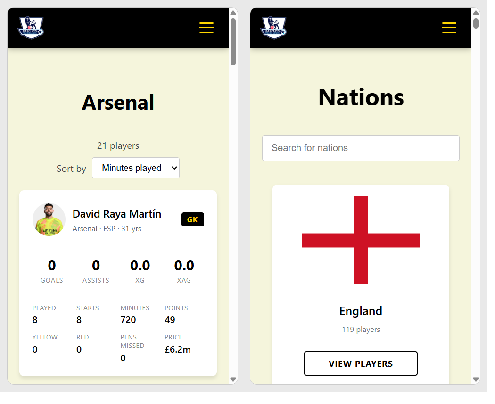

# PremTeam

[](https://github.com/MohitMadnani/PremTeam/actions/workflows/ci.yml)
[](https://github.com/MohitMadnani/PremTeam/actions/workflows/update-data.yml)

A Premier League player stats browser for the current season. Browse every player by team, nation or position, or search by name, with fantasy price, points and injury news on each card.



<table>
  <tr>
    <td></td>
    <td></td>
  </tr>
</table>

<p align="center"></p>

## Features

- Browse by **team** (with badges), **nation** (flags and player counts) or **position**, or **search** by name
- Player cards with goals, assists, xG, xAG, minutes, cards, matches played, fantasy price and points
- **Availability banners** for doubtful, injured and suspended players, with the latest news
- Sort by minutes, goals, assists, xG, points, price or name
- Responsive layout with a mobile menu
- Data refreshes itself every few hours on match weekends

## How it works

```
Fantasy Premier League API
        |   fetch.py + load.py  (GitHub Actions, Fri-Mon, every 3 hours)
        v
Supabase (Postgres)  -->  Spring Boot API  -->  React app
```

| Part | Technology |
|---|---|
| Frontend | React 19, Vite, React Router, framer-motion, SCSS |
| Backend | Spring Boot 4.1, Java 21, Spring Data JPA (read-only) |
| Database | Postgres on Supabase |
| Data pipeline | Python (requests, pandas, psycopg) |
| Automation | GitHub Actions: scheduled data refresh and CI |

## Getting started

You need Java 21, Node 22, Python 3.10+ and a Supabase project.

### 1. Database

Run `DataScraping/schema.sql` in the Supabase SQL editor. It creates the `team`, `player` and `player_season` tables, the `player_stats` view the API reads, and read-only row level security.

### 2. Load the data

Copy `.env.example` to `.env` and set `DATABASE_URL` to your Supabase **Session pooler** connection string (Supabase > Connect). Then:

```
cd DataScraping
pip install -r requirements.txt
python fetch.py
python load.py data/stats-2026-27.csv
```

The loader upserts, so you can re-run it at any time to refresh the numbers.

### 3. Backend

The backend reads its settings from environment variables (it does not read `.env`):

| Variable | Value |
|---|---|
| `DB_URL` | `jdbc:postgresql://<pooler-host>:5432/postgres?sslmode=require&preferQueryMode=simple` |
| `DB_USERNAME` | `postgres.<project-ref>` |
| `DB_PASSWORD` | your database password |
| `PORT` | optional, defaults to 8080 |
| `CORS_ALLOWED_ORIGINS` | optional, comma-separated origin patterns |

```
cd Backend
./mvnw spring-boot:run
```

### 4. Frontend

```
cd frontend
npm install
npm run dev
```

The dev server runs on port 3000 and forwards `/api` requests to the backend on port 8080. If your backend is on another port, put `VITE_PROXY_TARGET=http://localhost:8081` in `frontend/.env.local`. For a production build, set `VITE_API_URL` to the deployed backend URL and run `npm run build`.

## API

All endpoints are `GET` and return JSON.

| Endpoint | Returns |
|---|---|
| `/api/v1/player` | Players for the latest season. Optional filters: `team`, `nation`, `position`, `name` (the first one given is used) |
| `/api/v1/player/teams` | Teams with their badge codes |
| `/api/v1/player/nations` | Nations with player counts |
| `/api/v1/player/positions` | The four positions: `GK`, `DF`, `MF`, `FW` |

## Automation

Two GitHub Actions workflows live in `.github/workflows/`:

- **Update player data** (`update-data.yml`) runs `fetch.py` and `load.py` every 3 hours from Friday to Monday (UTC), when the games are played. It needs a repository secret named `DATABASE_URL` (Settings > Secrets and variables > Actions) holding the Session pooler string. You can also run it by hand from the Actions tab.
- **CI** (`ci.yml`) runs on every pull request and push to `master`: the backend tests (an in-memory database, no secrets), a production build of the frontend, and a syntax check of the data scripts.

Run the same checks locally with `./mvnw test` in `Backend/` and `npm run build` in `frontend/`.

## Project layout

| Folder | What it is |
|---|---|
| `frontend/` | The React app |
| `Backend/` | The Spring Boot API and its tests |
| `DataScraping/` | `fetch.py` downloads the stats, `load.py` upserts them into Supabase, `schema.sql` defines the tables |
| `.github/workflows/` | The data refresh and CI workflows |

## Data notes

- The Fantasy Premier League API only covers the current season and lists players who have played at least one minute.
- It has no penalties scored, so the app shows penalties missed instead.
- Matches played is counted from each player's match history.
- Team names are the API's short names, such as "Man City" and "Spurs".
- Player photos and team badges are loaded from the Premier League's own image servers.
